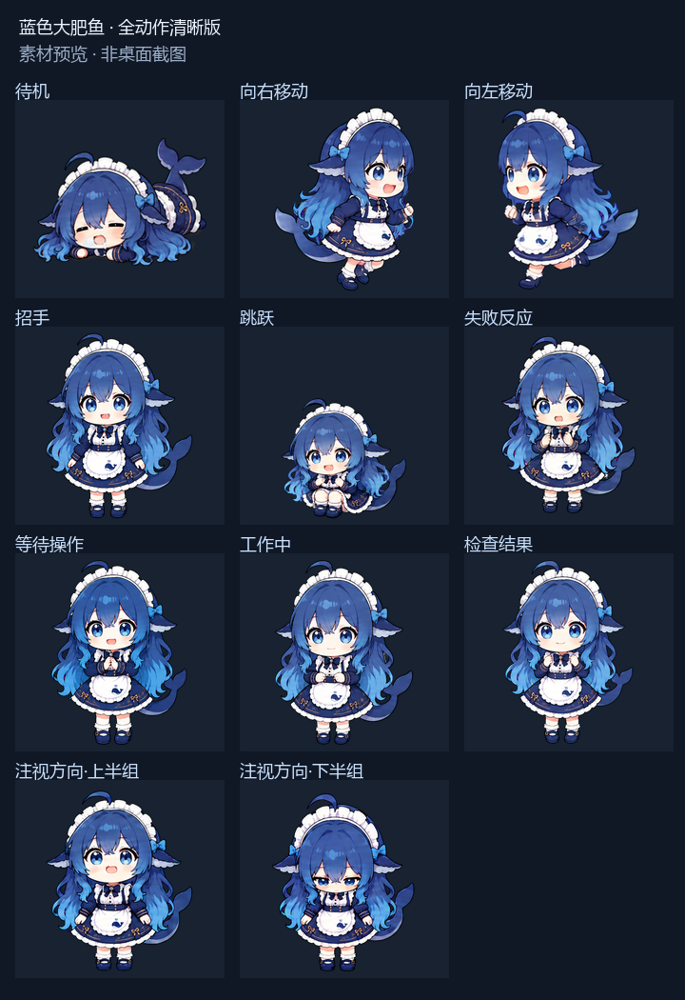

# 蓝色大肥鱼 · 全动作核对版

适用于支持 v2 图集的 Codex 桌面应用。此包是桌宠素材，不是独立程序；不启动服务器，不需要 Node.js、Python或管理员权限。

**原项目：[YuSec2021/blue-whale-maid](https://github.com/YuSec2021/blue-whale-maid)，仓库维护者：YuSec2021。** 本仓库由 YinMnJi 分享清晰化修复与分帧适配版本；角色与原始素材不是上传者原创，原画作者尚未独立核实。请阅读 [来源与许可状态](NOTICE.md)：原仓库没有明确再分发许可证，公开可见及署名不等于获得授权；本仓库不替原权利人授予 MIT、CC0 或其他开放许可。



## 下载与安装

1. 点击本仓库的 **Code → Download ZIP**，解压。
2. 找到直接包含 `pet.json` 与 `spritesheet.webp` 的文件夹，将其重命名为 `blue-whale-maid-actions-verified-20261012`。不要套两层同名文件夹。
3. 在 Codex 的 **设置 → Pets → Open folder / 打开文件夹** 中，将这个文件夹复制到应用打开的宠物目录。Windows 默认位置是 `%USERPROFILE%\.codex\pets`，以应用打开的目录为准。
4. 回到 Pets，点击 **Refresh**，选择 **蓝色大肥鱼 · 全动作核对版 20261012**。

本包不会修改其他宠物、账号设置或桌宠大小，不会自动删除旧版。

## 通过安装链接导入

支持此功能的桌面应用也可使用以下链接。GitHub 可能不会将自定义协议显示为可点击链接：请复制整行到浏览器地址栏，允许浏览器打开 Codex，并完成安装确认。

```text
codex://pets/install?name=%E8%93%9D%E8%89%B2%E5%A4%A7%E8%82%A5%E9%B1%BC%20%C2%B7%20%E5%85%A8%E5%8A%A8%E4%BD%9C%E6%A0%B8%E5%AF%B9%E7%89%88%2020261012&imageUrl=https%3A%2F%2Fraw.githubusercontent.com%2FYinMnJi%2Fblue-whale-maid-clear%2Fmain%2Fspritesheet.webp&spriteVersionNumber=2
```

图片直链：[spritesheet.webp](https://raw.githubusercontent.com/YinMnJi/blue-whale-maid-clear/main/spritesheet.webp)。如果你所在网络无法访问 GitHub 或其图片域名，请使用下载后复制文件夹的安装方式。安装链接遵循 [官方安装链接说明](https://learn.chatgpt.com/docs/app/commands#pets)；相关功能的可用性以应用版本为准。

## 规格与修复范围

- 无损透明 WebP，1536×2288，8列×11行，单帧192×208；73个有效帧。
- 九组状态：待机、向右移动、向左移动、招手、跳跃、失败、等待、工作中、检查结果；另含16个注视方向。
- 保留六帧已确认的清晰待机，其余67帧经图像编辑修复、透明背景清理与对齐；不是仅放大旧图。
- 注视帧按统一站立尺寸适配，减少切换时角色尺寸突变。
- 原始动作条带对应内容已核对；图集逐帧检查、空格透明检查、无损回读及哈希校验通过。用户已确认在本地选中此版并正常显示。

## 已知限制

- 动作由 Codex 原生任务与交互状态控制，`pet.json` 不提供任意播放动作按钮；本包不修改应用运行逻辑。
- 目前未逐一实测所有原生触发。用户反馈等待、检查结果等动作不容易触发；本发布**不声称已经修复动作触发问题**。
- 图集是固定的192×208单帧，过度放大仍会受原始像素尺寸限制，不代表4K原画或矢量素材。
- `preview.png` 是素材代表帧预览，不是桌面运行录像。
- 此版针对支持 v2 的桌面应用；不保证兼容只接受九行图集的网页上传器或其他桌宠软件。

## 文件

安装必需：`pet.json`、`spritesheet.webp`。说明与校验：`README.md`、`NOTICE.md`、`preview.png`、`validation.json`、`SHA256SUMS.txt`。

本仓库不含账户配置、云宠物ID、聊天记录、工作工程、备份或额外后台服务。未附加第三方素材的再分发许可证；使用与传播前请确认相应权利。
